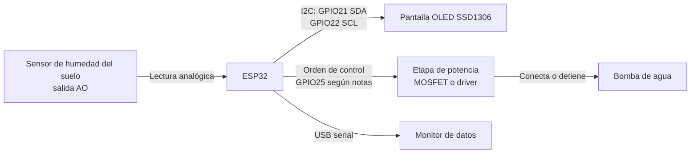
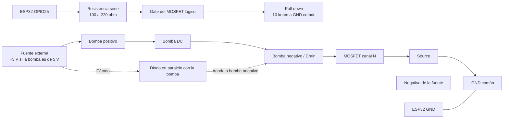
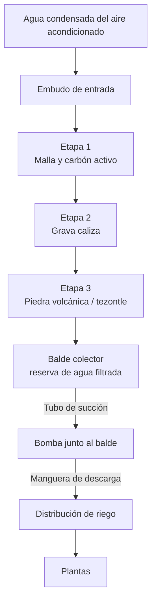
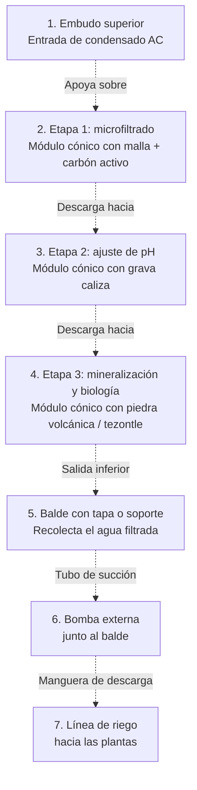

# Diagramas del sistema de riego

Documento de referencia para la página web y la exposición. Los diagramas se escribieron en Mermaid para poder mostrarlos en la web o exportarlos a una imagen. Las conexiones eléctricas parten de las notas del proyecto; el orden hidráulico y el despiece del filtro son conceptuales hasta cotejarlos con el montaje físico.

## Leyenda de estado

- **Documentado:** aparece en las notas y conexiones compartidas del proyecto.
- **Confirmado por el equipo:** el prototipo físico sí filtra agua y riega las plantas.
- **Por cotejar:** revisar contra el filtro, la bomba y el cableado reales antes de presentar el diagrama como plano final.

## 1. Diagrama electrónico de control

Representa la lectura y la orden de riego. El ESP32 recibe la lectura del sensor y, cuando la condición requiere riego, manda una señal a la etapa que controla la bomba. El umbral exacto y la condición de apagado deben coincidir con el firmware actual.

### Secuencia de control en palabras

1. El sensor observa la humedad de la tierra.
2. El ESP32 interpreta la lectura y la compara con el criterio de riego configurado.
3. Si hace falta agua, envía una orden a la etapa de potencia para que active la bomba.
4. Al alcanzar la condición de detención, el control apaga la bomba.
5. La pantalla informa el estado. La pantalla no alimenta ni acciona directamente la bomba.

**Pendiente de cotejar:** el sketch revisado anteriormente leía el sensor y actualizaba la pantalla, pero no mostraba el control de GPIO25. Confirmar que el firmware físico actual ya contiene la lógica de encendido y apagado antes de publicar este flujo como comportamiento del código.

## 2. Diagrama electrónico de potencia

Este es un esquema funcional de baja tensión para una bomba. Las notas previas consideran una bomba de 5 V, MOSFET, resistencia de gate, resistencia pull-down y diodo de rueda libre. Confirmar los valores y los modelos exactos del montaje.

### Conexiones resumidas

| Punto | Conexión | Estado/nota |
|---|---|---|
| GPIO25 | A Gate por resistencia serie de 100–220 ohm | Aparece en las notas; confirmar que el firmware físico lo controla |
| Gate | A GND mediante pull-down de 10 kohm | Mantiene apagada la etapa durante el arranque |
| Bomba positivo | Positivo de su fuente externa | Usar el voltaje nominal de la bomba real |
| Bomba negativo | Drain del MOSFET | Nodo conmutado |
| Source | GND de la fuente y GND del ESP32 | Tierra común |
| Diodo de rueda libre | En paralelo con la bomba: cátodo al positivo, ánodo al nodo Drain | Confirmar polaridad y capacidad del componente real |

**Nota de seguridad para el diseño:** no alimentar la bomba desde un GPIO ni desde la salida de 3,3 V del ESP32. Las notas identifican un IRF520 en la foto, pero la señal de control del ESP32 es de 3,3 V; revisar la etapa real y usar un MOSFET/driver adecuado para esa señal y para la corriente de arranque de la bomba. No conectar la bomba hasta verificar su fuente, el pinout del transistor y la protección.

## 3. Diagrama hidráulico

Según la imagen del filtro real, el agua condensada del aire acondicionado entra por la parte superior, pasa por tres etapas de filtrado y cae en un balde colector. Una bomba ubicada junto al balde toma el agua recolectada y la envía al riego.

| Tramo | Elemento inicial → final | Dato que falta confirmar |
|---|---|---|
| Captación | Condensado del aire acondicionado → embudo superior | Forma de recolectar y conducir el condensado |
| Filtrado por gravedad | Embudo → malla/carbón → grava caliza → piedra volcánica/tezontle | Cantidad de material, capas, separación y mecanismo de soporte |
| Recolección | Salida de etapa 3 → balde | Ubicación y forma de fijar el balde |
| Bombeo | Balde → tubo de succión → bomba externa | Altura de succión, diámetro y posición de bomba |
| Riego | Bomba → manguera de descarga/distribución → plantas | Tipo de salida, recorrido y número de plantas |

Las funciones indicadas en la imagen son: etapa 1, microfiltrado; etapa 2, ajuste de pH; etapa 3, mineralización y biología. Presentarlas como finalidad del diseño, no como resultados demostrados, hasta contar con pruebas del agua antes y después del filtro.

## 4. Diagrama mecánico del filtro real

El diagrama se basa en la imagen compartida del filtro real: módulos cónicos apilados, con el medio filtrante en cada etapa, descarga hacia un balde y una bomba externa a un costado. Es un esquema de ensamblado, no está a escala; las medidas y uniones deben tomarse del prototipo.

### Orden de ensamblado mostrado

1. Colocar el balde colector en la base y asegurar que pueda sostener el conjunto apilado.
2. Montar sobre el balde el módulo de piedra volcánica/tezontle (etapa 3), con una salida que descargue al balde.
3. Colocar encima el módulo de grava caliza (etapa 2) y luego el módulo de malla y carbón activo (etapa 1).
4. Poner el embudo superior de captación, alineando las salidas de las etapas para que el agua fluya hacia abajo.
5. Instalar la bomba al costado o en la ubicación mostrada, conectar la succión desde el balde y llevar la descarga hacia la línea de riego.
6. Comprobar que las piezas queden estables y que no haya fugas o desbordamientos durante una prueba con agua.

Los medios filtrantes aparecen descritos de arriba hacia abajo: malla y carbón activo, grava caliza, y piedra volcánica/tezontle. El filtro y el recipiente se deben poder desmontar para limpiar o reponer el material sin desarmar la instalación de riego.

## Datos para completar el plano final

- Medidas y materiales de cada embudo/módulo, el balde y sus apoyos.
- Cantidad o espesor de malla, carbón activo, grava caliza y piedra volcánica/tezontle.
- Forma de fijar los módulos entre sí y evitar que el material pase de una etapa a otra.
- Diámetro de salidas entre etapas y conexiones del balde, bomba y mangueras.
- Posición y método de fijación de la bomba junto al recipiente.
- Verificación del propósito de cada medio filtrante mediante pruebas de agua.
- Confirmación del circuito de control físico y del firmware que activa la bomba.

## Uso en la página web

Mostrar los diagramas de control y potencia en la sección del sistema; el recorrido hidráulico en “Cómo circula el agua”; y el despiece del filtro en una galería de ensamblado. Etiquetar este diagrama mecánico como **Basado en la imagen del prototipo · medidas por confirmar** hasta añadir dimensiones reales.
